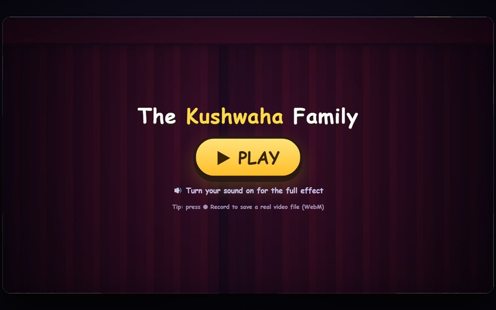

# The Kushwaha Family - Animated Intro

A short animated family introduction, timed frame by frame in the browser.

**[Open the live site](https://ajeet-iitk.github.io/kushwaha1/)**

## What it does

A one-page animated introduction for the family: names, faces and a few lines of story, revealed in sequence. The animation is driven by a `requestAnimationFrame` timeline rather than a video file, and the audio cues use the Web Audio API.

## Features

- Frame-timed reveal sequence, no video assets
- Portrait images with captions
- Sound cues generated through `AudioContext`
- Everything in one HTML page

## Run locally

Open `index.html`, or watch the hosted version:

<https://ajeet-iitk.github.io/kushwaha1/>

## Files

| File | Purpose |
| --- | --- |
| `index.html` | Landing page |
| `kushwaha-family-intro.html` | The animation |

---

Part of [my collection of small projects](https://github.com/Ajeet-iitk).
